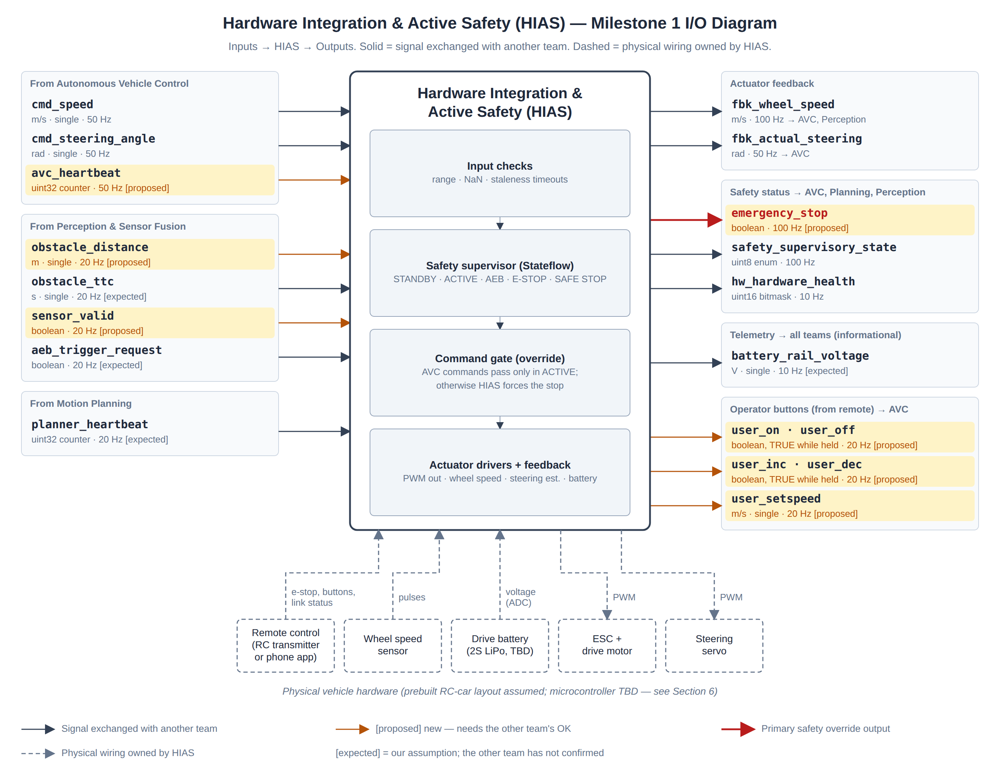
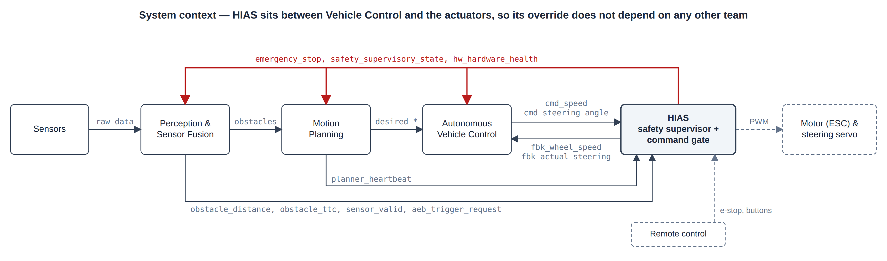

# ISE 350 Milestone 1 — Hardware Integration & Active Safety (HIAS)

**System Connections and Interface Plan** · Revised October 4, 2026 · Team: Colin Iorio, Jessica Horncastle, Stephen Marth

> **How to read the status tags.** Each signal has a status. **Agreed:** the same definition is in AVC's Milestone 1 document. **Expected:** we wrote it from what we expect; the sending or receiving team has not confirmed it yet. **Proposed:** new in this revision; the other team needs to accept it. Every unresolved value is marked **TBD** and listed in Section 7.

## Purpose

HIAS is the bridge between the software and the physical vehicle, and it is the part of the system that can always stop the car. It has three jobs:

1. **Actuation.** Turn AVC's speed and steering commands (`cmd_speed`, `cmd_steering_angle`) into motor (ESC) and steering-servo signals.
2. **Feedback.** Measure and report the vehicle's state to the other teams: wheel speed, steering angle, battery voltage and hardware health.
3. **Active safety.** Run an independent safety supervisor. It watches Perception's obstacle data, the health of the other subsystems and the hardware. When something is unsafe, it overrides AVC's commands and brings the vehicle to a safe stop.

HIAS sits in the actuation path (AVC → HIAS → motor and servo), so its override does not depend on any other team obeying it: AVC's commands only reach the wheels when HIAS lets them through. Section 6 answers the Team 4 questions from the assignment (hardware, microcontroller, connections, stop conditions, override, sensor loss).

<!-- \landscape -->

## 1. Subsystem Diagram

<!-- \pagebreak -->

Editable sources for both figures are in `milestone-1/diagrams/` (`.drawio` opens in diagrams.net, the tool AVC used).

<!-- \portrait -->

## 2. Input/Output Table

### 2.1 Summary

| # | Signal | Source → Destination | Description | Type | Units | Status |
|---|---|---|---|---|---|---|
| 1 | `cmd_speed` | AVC → HIAS | Speed command from AVC's speed controller | single | m/s | Agreed |
| 2 | `cmd_steering_angle` | AVC → HIAS | Road-wheel steering angle command | single | rad | Agreed |
| 3 | `avc_heartbeat` | AVC → HIAS | AVC alive counter | uint32 | counts | Proposed |
| 4 | `obstacle_distance` | Perception → HIAS | Distance to the closest obstacle ahead | single | m | Proposed |
| 5 | `obstacle_ttc` | Perception → HIAS | Time-to-collision with the closest obstacle ahead | single | s | Expected |
| 6 | `sensor_valid` | Perception → HIAS | Perception's obstacle data is trustworthy | boolean | — | Proposed |
| 7 | `aeb_trigger_request` | Perception → HIAS | Advisory "collision imminent" flag | boolean | — | Expected |
| 8 | `planner_heartbeat` | Motion Planning → HIAS | Planner alive counter | uint32 | counts | Expected |
| 9 | `fbk_wheel_speed` | HIAS → AVC, Perception | Measured vehicle speed | single | m/s | Agreed |
| 10 | `fbk_actual_steering` | HIAS → AVC | Estimated actual road-wheel angle | single | rad | Agreed |
| 11 | `emergency_stop` | HIAS → AVC, Motion Planning, Perception | Override flag: HIAS is stopping the vehicle | boolean | — | Proposed |
| 12 | `safety_supervisory_state` | HIAS → AVC, Motion Planning, Perception | Safety supervisor state (enum) | uint8 | — | Agreed (state 4 proposed) |
| 13 | `hw_hardware_health` | HIAS → AVC, Motion Planning, Perception | Diagnostic fault and warning flags | uint16 | bitmask | Agreed (bits 5–10 proposed) |
| 14 | `battery_rail_voltage` | HIAS → all teams (informational) | Drive battery voltage | single | V | Expected |
| 15 | `user_on`, `user_off`, `user_inc`, `user_dec`, `user_setspeed` | HIAS (from remote control) → AVC | Operator buttons for AVC's cruise control | boolean / single | — / m/s | Proposed |

Conventions used in every signal below:

- **Frame.** Vehicle frame per ISO 8855: +X forward, +Y left, +Z up. Angles are positive counter-clockwise seen from above, so a left turn is positive.
- **Staleness rule.** A signal is *stale* when no new value has arrived for **3 consecutive update periods**: 60 ms at 50 Hz, 150 ms at 20 Hz, 30 ms at 100 Hz and 300 ms at 10 Hz. Stale is treated exactly like invalid. If a team settles on a different rate than the one assumed here, the timeout follows the agreed rate (for example 300 ms if Perception runs at 10 Hz).
- **SAFE_STOP** means the controlled stop described in Section 2.4: HIAS ignores AVC's speed command and ramps the vehicle to 0 m/s.

### 2.2 Inbound signals (into HIAS)

**Signal 1: `cmd_speed`** — shown as `new_speed` on AVC's diagram

- Source / Destination: Autonomous Vehicle Control → HIAS
- Description: Speed command from AVC's speed controller (ACC). HIAS converts it to an ESC pulse with a calibrated, open-loop map. AVC closes the speed loop by comparing `fbk_wheel_speed` with the desired speed and adjusting `cmd_speed`. HIAS does not run a second speed loop, but it does apply a speed cap and an acceleration limit (start at 1 m/s²) so that a wound-up command can never make the car lurch. (AVC to confirm; see Section 7, item A1.)
- Data type / Units: single / m/s
- Expected range: 0.0 to 3.5 m/s, forward only. The real top speed is TBD with the chassis. During early testing HIAS also enforces a configurable speed cap (start at 1.0 m/s).
- Update rate: 50 Hz (20 ms)
- Frame: vehicle frame, +X forward
- Invalid: NaN, < 0.0 m/s, > 3.5 m/s, or stale (> 60 ms)
- If unavailable or invalid: HIAS enters SAFE_STOP. It ignores `cmd_speed` and ramps the drive command to 0 m/s at the safe-stop deceleration (start with 1.5 m/s², TBD in testing). The ramp starts within 100 ms of the last valid sample.

**Signal 2: `cmd_steering_angle`** — shown as `steering_angle` on AVC's diagram

- Source / Destination: Autonomous Vehicle Control → HIAS
- Description: Road-wheel steering angle command from AVC's lane-keeping / path-tracking controller. HIAS converts radians to a servo pulse using its calibration (center trim, gain, limits).
- Data type / Units: single / rad
- Expected range: −0.436 to +0.436 rad (±25°; the real mechanical limit is TBD). Values with 0.436 < |x| ≤ 0.5 rad are accepted but saturated to ±0.436 rad to protect the servo.
- Update rate: 50 Hz (20 ms)
- Frame: bicycle-model road-wheel angle at the front axle; positive = left turn
- Invalid: NaN, |x| > 0.5 rad, or stale (> 60 ms)
- If unavailable or invalid: HIAS ramps the steering to 0 rad (straight) at a limited rate and enters SAFE_STOP.

**Signal 3: `avc_heartbeat`** — *Proposed*

- Source / Destination: Autonomous Vehicle Control → HIAS
- Description: Alive counter. AVC adds 1 every control cycle and sends it with the commands. Without it, a frozen AVC that keeps sending its last command looks valid to HIAS.
- Data type / Units: uint32 / counts
- Expected range: 0 to 4,294,967,295. It wraps to 0, and the wrap is normal.
- Update rate: 50 Hz (20 ms)
- Frame: N/A
- Invalid: unchanged for > 60 ms, or the value jumps backwards (AVC restarted). Any increase is fine, since HIAS may sample at a different rate than AVC counts.
- If unavailable or invalid: AVC's commands are treated as stale and HIAS enters SAFE_STOP.

**Signal 4: `obstacle_distance`** — *Proposed* (the template's example interface)

- Source / Destination: Perception & Sensor Fusion → HIAS (also useful to Motion Planning)
- Description: Distance from the front bumper to the closest obstacle in the vehicle's path. HIAS uses it in its own AEB check, and as the backup when `obstacle_ttc` is unavailable.
- Data type / Units: single / m
- Expected range: 0.0 to 4.0 m (depends on the sensor; TBD with Perception). Perception reports 4.0 m (maximum range) when nothing is detected.
- Update rate: 20 Hz (50 ms) requested; 10 Hz minimum. TBD with Perception.
- Frame: vehicle frame, +X forward, measured from the front bumper
- Invalid: NaN, < 0, `sensor_valid` = FALSE, or stale (> 150 ms)
- If unavailable or invalid: HIAS enters SAFE_STOP, because the vehicle cannot see what is ahead.

**Signal 5: `obstacle_ttc`** — *Expected*

- Source / Destination: Perception & Sensor Fusion → HIAS
- Description: Time-to-collision with the closest obstacle in the travel path: distance divided by closing speed. **0 s is a valid value and means contact.** It is the most dangerous reading, not a fault. Perception can get closing speed from successive distance readings, or from `fbk_wheel_speed`, which HIAS sends them.
- Data type / Units: single / s
- Expected range: 0.0 to 10.0 s, saturated. 10.0 s means there is no closing obstacle: none detected, the obstacle is moving away, or TTC is above 10 s. Never Inf or negative.
- Update rate: 20 Hz (50 ms)
- Frame: vehicle frame, +X forward
- Invalid: NaN, < 0, `sensor_valid` = FALSE, or stale (> 150 ms)
- If unavailable or invalid: HIAS computes its own TTC = `obstacle_distance` / `fbk_wheel_speed`. This assumes the obstacle is stationary, which is fine for our test course. If `obstacle_distance` is also unavailable, HIAS enters SAFE_STOP.

**Signal 6: `sensor_valid`** — *Proposed* (template starting signal)

- Source / Destination: Perception & Sensor Fusion → HIAS
- Description: TRUE when Perception's obstacle outputs (`obstacle_distance`, `obstacle_ttc`, `aeb_trigger_request`) are fresh and trustworthy. FALSE means a sensor fault, a blocked view, or implausible data.
- Data type / Units: boolean / N/A
- Expected range: TRUE or FALSE
- Update rate: 20 Hz (50 ms)
- Frame: N/A
- Invalid: stale (> 150 ms)
- If unavailable or FALSE: all Perception data is treated as invalid and HIAS enters SAFE_STOP.

**Signal 7: `aeb_trigger_request`** — *Expected*

- Source / Destination: Perception & Sensor Fusion → HIAS
- Description: Advisory flag. Perception sets it TRUE when it believes a forward collision is imminent, and holds it TRUE for as long as the condition lasts (not a one-cycle pulse). HIAS combines it with its own threshold checks using OR. **The final AEB decision belongs to HIAS** (Section 6.6).
- Data type / Units: boolean / N/A
- Expected range: TRUE or FALSE
- Update rate: 20 Hz (50 ms)
- Frame: N/A
- Invalid: `sensor_valid` = FALSE, or stale (> 150 ms)
- If unavailable or invalid: HIAS relies on its own checks of `obstacle_ttc` and `obstacle_distance`. Losing this signal alone does not stop the vehicle.

**Signal 8: `planner_heartbeat`** — *Expected*

- Source / Destination: Motion Planning → HIAS
- Description: Alive counter. Motion Planning adds 1 every planning cycle. HIAS's watchdog uses it to detect a stalled or crashed planner.
- Data type / Units: uint32 / counts
- Expected range: 0 to 4,294,967,295; wraps to 0 (after about 6.8 years at 20 Hz)
- Update rate: the planner's cycle rate, assumed 20 Hz (50 ms). TBD with Motion Planning; AVC's document assumes Motion Planning runs at 50 Hz.
- Frame: N/A
- Invalid: unchanged for 3 planner periods (150 ms at 20 Hz), or the value jumps backwards (planner restarted). Any increase is fine.
- If unavailable or invalid: HIAS declares a planner failure, sets `hw_hardware_health` bit 4 and enters SAFE_STOP.

### 2.3 Outbound signals (from HIAS)

**Signal 9: `fbk_wheel_speed`** — shown as `vehicle_speed` on AVC's diagram

- Source / Destination: HIAS → Autonomous Vehicle Control, Perception & Sensor Fusion
- Description: Measured vehicle speed from a wheel-speed sensor (Hall-effect or optical; TBD, and a prebuilt RC car will probably need one added). It equals ground speed while the wheels are not slipping. HIAS is the single source of measured speed.
- Data type / Units: single / m/s
- Expected range: 0.0 to 4.5 m/s (maximum command plus 1.0 m/s margin for overshoot). Forward only, because a single-channel sensor cannot tell direction.
- Update rate: 100 Hz (10 ms)
- Frame: vehicle frame, +X forward
- Invalid: NaN (HIAS sends NaN when the sensor faults), < 0, > 4.5 m/s, or stale (> 30 ms)
- If unavailable or invalid: Receivers must not keep using the last value, and AVC holds its speed controller with the command at 0 m/s. HIAS sets `hw_hardware_health` bit 7 and enters SAFE_STOP, because it can no longer confirm the vehicle's speed or compute a backup TTC.

**Signal 10: `fbk_actual_steering`**

- Source / Destination: HIAS → Autonomous Vehicle Control
- Description: **Estimated** road-wheel angle: the commanded angle passed through a servo model (rate limit, calibration offset, saturation). Hobby servos do not report their position, so this is not a measurement unless we choose a servo with position feedback (TBD). AVC should not treat it as an independent sensor.
- Data type / Units: single / rad
- Expected range: −0.436 to +0.436 rad (±25°)
- Update rate: 50 Hz (20 ms)
- Frame: same as `cmd_steering_angle` (front-axle road-wheel angle, positive = left)
- Invalid: NaN, |x| > 0.5 rad, or stale (> 60 ms)
- If unavailable or invalid: AVC assumes the steering reached the commanded angle (ideal actuator).

**Signal 11: `emergency_stop`** — *Proposed* (the template's main safety signal)

- Source / Destination: HIAS → Autonomous Vehicle Control (must act), Motion Planning (must act), Perception & Sensor Fusion (informational)
- Description: Override flag. It is **TRUE whenever HIAS is not passing AVC's commands through** to the motor and steering, that is, whenever `safety_supervisory_state` is not 1 (ACTIVE). That covers standby, AEB, an operator e-stop and a safe stop. HIAS stops the vehicle itself in all of these cases; this signal tells the other teams to follow along.
  - **AVC must:** enter its Emergency Stop mode, set `cmd_speed` = 0, and reset or hold its PI integrators so nothing winds up and the car does not lurch when the stop is released.
  - **Motion Planning must:** stop advancing the plan, output `desired_speed` = 0, and replan from the current position after release.
  - **Perception:** no action, but it must **keep publishing obstacle data in every state**, because HIAS uses that data to decide when an AEB stop can be released.
- Data type / Units: boolean / N/A
- Expected range: TRUE or FALSE. The power-up value is TRUE.
- Update rate: 100 Hz (10 ms), and sent immediately when it changes
- Frame: N/A
- Invalid: stale (> 30 ms), or disagrees with `safety_supervisory_state`
- If unavailable or invalid: Receivers treat it as TRUE (fail-safe).

**Signal 12: `safety_supervisory_state`**

- Source / Destination: HIAS → Autonomous Vehicle Control, Motion Planning, Perception & Sensor Fusion
- Description: Current state of the HIAS safety supervisor (Stateflow). The states, their meanings and the AVC mode mapping are in Section 2.4.
- Data type / Units: uint8 (enumeration) / N/A
- Expected range: 0 to 4. 255 is reserved: HIAS never sends it, and receivers may use it internally to mean "unknown".
- Update rate: 100 Hz (10 ms)
- Frame: N/A
- Invalid: any value outside 0–4, or stale (> 30 ms)
- If unavailable or invalid: Receivers treat the safety supervisor as offline. AVC goes to its Error mode and commands 0 m/s; Motion Planning stops issuing motion.

**Signal 13: `hw_hardware_health`**

- Source / Destination: HIAS → Autonomous Vehicle Control, Motion Planning, Perception & Sensor Fusion
- Description: Diagnostic flags that explain why HIAS stopped or is warning (bit map in Section 2.4). This signal is for diagnosis only. Time-critical stops travel on `emergency_stop` and `safety_supervisory_state` at 100 Hz.
- Data type / Units: uint16 / bitmask
- Expected range: 0x0000 to 0x07FF. Bits 11–15 are reserved and always 0.
- Update rate: 10 Hz (100 ms)
- Frame: N/A
- Invalid: any reserved bit set, or stale (> 300 ms)
- If unavailable or invalid: Receivers halt trajectory execution and alert the operator.

**Signal 14: `battery_rail_voltage`**

- Source / Destination: HIAS → all teams, informational (logging / telemetry). No team has to act on it; the battery decision reaches the other teams through `hw_hardware_health` bits 1 and 8.
- Description: Filtered voltage of the main drive battery, measured by the microcontroller's ADC through a resistor divider. The filter is about a 1 s average so that motor-load sag does not trip the thresholds. HIAS's own thresholds: **warning below 6.8 V for 1 s** (bit 1); **critical below 6.4 V for 2 s → SAFE_STOP** (bit 8).
- Data type / Units: single / V
- Expected range: 6.0 to 8.4 V for a 2S LiPo (3.0–4.2 V per cell, nominal 7.4 V). The battery type is TBD; if the car comes with a NiMH pack, the thresholds change.
- Update rate: 10 Hz (100 ms)
- Frame: battery positive terminal, referenced to chassis ground
- Invalid: NaN, > 8.6 V (over-voltage or wiring fault), < 5.0 V (sense wire disconnected), or stale (> 300 ms)
- If unavailable or invalid: Receivers need to do nothing (informational). Inside HIAS, an unknown battery state sets bit 8 and causes a SAFE_STOP, because a brownout could reset the safety controller.

**Signal 15: operator commands** — `user_on`, `user_off`, `user_inc`, `user_dec`, `user_setspeed` — *Proposed*

- Source / Destination: HIAS (relayed from the remote control) → Autonomous Vehicle Control
- Description: AVC's diagram has these cruise-control inputs, but no team was listed as their source. The vehicle will be driven with a remote control (an RC transmitter or a phone app), and HIAS owns that radio link, so HIAS reads the buttons and passes them to AVC unchanged. HIAS keeps two buttons for itself, **E-STOP** and **ARM/RESET**. `user_on` can never clear a stop; only HIAS's ARM/RESET can.

| Signal | Type | Units | Range | Meaning |
|---|---|---|---|---|
| `user_on` | boolean | — | TRUE/FALSE | TRUE while the ON button is held; AVC acts on the rising edge |
| `user_off` | boolean | — | TRUE/FALSE | TRUE while OFF is held |
| `user_inc` | boolean | — | TRUE/FALSE | TRUE while + is held |
| `user_dec` | boolean | — | TRUE/FALSE | TRUE while − is held |
| `user_setspeed` | single | m/s | 0.0–3.5 | Speed set-point from the remote. TBD with AVC: a numeric value, or a SET button that captures the current speed |

- Update rate: 20 Hz (50 ms). The buttons are sent as levels ("held") rather than one-cycle pulses, so a press is never missed when the two teams run at different rates.
- Frame: N/A
- Invalid: stale (> 150 ms)
- If unavailable or invalid: If the remote link is lost for more than 0.5 s, HIAS sends every button as FALSE, sets `hw_hardware_health` bit 9 and enters the latched E-STOP state.

### 2.4 Shared definitions

**Safety supervisor states (`safety_supervisory_state`).** States 0–3 are unchanged from the earlier draft, which AVC already copied. State 4 is new.

| Value | Name | When | Motor | Steering | `emergency_stop` | AVC mode |
|---|---|---|---|---|---|---|
| 0 | SYS_INIT_STANDBY | Power-up, or after any stop has finished; waiting for the operator to arm | Neutral (0) | 0 rad | TRUE | Stop |
| 1 | SYS_NOMINAL_ACTIVE | Normal driving | AVC's command (limits applied) | AVC's command | FALSE | Normal |
| 2 | SYS_AEB_INTERVENTION | Collision imminent (Section 6.6) | Maximum braking (Section 6.3) | Follows AVC if valid | TRUE | Emergency Stop |
| 3 | SYS_ESTOP_LATCHED | Operator pressed E-STOP, or the remote link was lost; latched | Neutral / brake immediately | Follows AVC if valid | TRUE | Emergency Stop |
| 4 | SYS_SAFE_STOP *(proposed)* | A required input is lost or invalid, battery critical, overspeed, or hardware fault | Ramp to 0 m/s at 1.5 m/s² (TBD). If Perception's data is what was lost, maximum braking instead, because the car is driving blind | Follows AVC if valid, else ramps to 0 rad | TRUE | Error |
| 255 | *(reserved)* | Never sent; receivers use it for "unknown" | — | — | — | Error |

- **Priority** when several conditions are true at once: E-STOP (3) > AEB (2) > SAFE_STOP (4) > ACTIVE (1).
- **Leaving a stop.** No stop state goes straight back to ACTIVE.
  - AEB returns to STANDBY once the vehicle is stopped (`fbk_wheel_speed` < 0.05 m/s) and the hazard has been clear for 1 s (TTC > 3.0 s and distance > 1.0 m).
  - SAFE_STOP returns to STANDBY once the vehicle is stopped and every input has been valid for 1 s.
  - E-STOP returns to STANDBY only after the E-STOP is released, the remote link is back, and the operator presses ARM/RESET.
- **STANDBY → ACTIVE** requires all of the following: the operator presses ARM, every input is valid, no critical health bit is set, and `cmd_speed` = 0. The last condition means AVC always starts from rest, so the car cannot lurch.
- **Steering rule (one rule for every state).** Steering follows `cmd_steering_angle` whenever that command is valid, so the vehicle keeps its lane while it stops. If the command is invalid or stale, HIAS ramps the steering to 0 rad. (Team decision; see Section 7, item S3.)

**Hardware health bits (`hw_hardware_health`).** Bits 0–4 are unchanged in meaning from the earlier draft, which AVC already copied. Bits 5–10 are new.

| Bit | Flag | Effect | Notes |
|---|---|---|---|
| 0 | E-stop pressed | E-STOP (3) | Remote E-STOP button, or the on-car kill switch if fitted |
| 1 | Battery low (warning) | Warning only | Filtered voltage < 6.8 V |
| 2 | ESC fault | SAFE_STOP (4) | Only if the ESC we choose can report faults; otherwise always 0 |
| 3 | Steering fault / stall | SAFE_STOP (4) | Needs steering position or current sensing; otherwise always 0 |
| 4 | Planner watchdog timeout | SAFE_STOP (4) | `planner_heartbeat` stale or restarted |
| 5 | AVC command stale / invalid | SAFE_STOP (4) | `cmd_speed`, `cmd_steering_angle` or `avc_heartbeat` |
| 6 | Perception data stale / invalid | SAFE_STOP (4) | Includes `sensor_valid` = FALSE |
| 7 | Wheel-speed sensor fault | SAFE_STOP (4) | |
| 8 | Battery critical or voltage-sense fault | SAFE_STOP (4) | < 6.4 V, or invalid reading |
| 9 | Remote link lost | E-STOP (3) | No packet from the remote for > 0.5 s |
| 10 | Overspeed | SAFE_STOP (4) | `fbk_wheel_speed` > 4.0 m/s for > 0.2 s |
| 11–15 | Reserved | — | Always 0 |

**Mapping to the template's starting signals.** The template lets each team rename signals. This is where each starting signal that involves Safety or Hardware went:

| Template signal | In this document |
|---|---|
| `obstacle_distance` | `obstacle_distance` (Signal 4, proposed) |
| `obstacle_detected` | Covered by `obstacle_distance` (4.0 m = nothing detected) and `sensor_valid` |
| `sensor_valid` | `sensor_valid` (Signal 6, proposed) |
| `motor_command` | `cmd_speed` in m/s; HIAS converts it to the ESC pulse |
| `steering_command` | `cmd_steering_angle` in rad; HIAS converts it to the servo pulse |
| `emergency_stop` | `emergency_stop` (Signal 11) |
| `system_mode` | `safety_supervisory_state` (Signal 12) |

## 3. Team Responsibilities

| Team member | Initial responsibility | Owns in this document |
|---|---|---|
| Colin Iorio | Physical chassis assembly, hardware selection, and testing | Section 6 hardware plan; `fbk_wheel_speed`, `fbk_actual_steering`, `battery_rail_voltage`; remote control link; Test 3 |
| Jessica Horncastle | Interface/data management, subsystem communication, and team coordination | Section 2 signal definitions and naming; Section 4 agreements with the other teams; Section 7 open-items list |
| Stephen Marth | Automatic Emergency Braking (AEB) programming and safety logic | Safety supervisor states and thresholds; `emergency_stop`, `safety_supervisory_state`, `hw_hardware_health`; Tests 1 and 2 |

## 4. Team Dependencies

HIAS has to communicate with all three other teams, because it connects the software commands to the physical vehicle and handles the safety override.

- **Autonomous Vehicle Control** sends us `cmd_speed` and `cmd_steering_angle` (plus the proposed `avc_heartbeat`). It receives `fbk_wheel_speed`, `fbk_actual_steering`, `emergency_stop`, `safety_supervisory_state`, `hw_hardware_health` and the operator buttons. *Status:* the command and feedback definitions match AVC's Milestone 1 document word for word. The names, `emergency_stop`, the heartbeat and the operator buttons still need AVC's confirmation (see the table below).
- **Perception & Sensor Fusion** sends us `obstacle_distance`, `obstacle_ttc`, `sensor_valid` and `aeb_trigger_request`. It receives `fbk_wheel_speed` (useful for TTC), `emergency_stop`, `safety_supervisory_state` and `hw_hardware_health`. *Status:* Perception has not shared its signals yet, so all four inputs are expected or proposed.
- **Motion Planning** sends us `planner_heartbeat`. It receives `emergency_stop`, `safety_supervisory_state` and `hw_hardware_health`. *Status:* Motion Planning has not shared its signals yet.

For Milestones 1–2, all of these are Simulink signals in the shared class model. On the real vehicle, the HIAS microcontroller will receive the other teams' signals over a link that is still to be chosen (Section 7, item I1).

**Questions for Perception & Sensor Fusion**

| Question | Our proposed answer | Status |
|---|---|---|
| What obstacle signals will you send us? | `obstacle_distance` (m), `obstacle_ttc` (s), `sensor_valid` and `aeb_trigger_request` (Section 2.2) | Awaiting Perception |
| Units and data types? | single m; single s; boolean; boolean | Awaiting Perception |
| How often is obstacle information updated? | 20 Hz requested, 10 Hz minimum | Awaiting Perception |
| How will you flag invalid or unavailable data? | `sensor_valid` = FALSE, or NaN in the value. HIAS also flags anything not updated for 3 periods. | Awaiting Perception |
| Who decides when AEB triggers? | HIAS decides, from `obstacle_ttc` and `obstacle_distance`. `aeb_trigger_request` is an extra input that can only add a stop, never block one. This matches the template ("Safety determines that the obstacle is too close"). | Proposed |
| What TTC or distance is dangerous? | Trigger AEB at TTC < 1.5 s or distance < 0.5 m. Release once TTC > 3.0 s and distance > 1.0 m. Starting values, to be tuned in Test 1 (Section 6.6). | Proposed |
| What do you send when there is no obstacle? | `obstacle_ttc` = 10.0 s and `obstacle_distance` = 4.0 m (sensor max), never Inf or NaN | Proposed |

**Questions for Autonomous Vehicle Control**

| Question | Our proposed answer | Status |
|---|---|---|
| What speed command will you send us? | `cmd_speed`: single, m/s, 0–3.5 m/s, 50 Hz. This is the name in your I/O table; your diagram still says `new_speed`. | Agreed in AVC M1 table; please relabel the diagram |
| What steering command will you send us? | `cmd_steering_angle`: single, **rad** (not rad/s or degrees), ±0.436 rad, positive = left, 50 Hz. Your diagram says `steering_angle`. | Units need fixing in both docs |
| Is `cmd_speed` a speed target or a motor effort? | A speed target in m/s. HIAS maps it to the ESC with a fixed calibration; your PI loop closes on `fbk_wheel_speed`. If you'd rather output a motor effort (0–1), tell us and we'll rename it. | Needs AVC decision |
| What should happen if a command is invalid or stops updating? | Stale after 60 ms. HIAS starts a controlled stop within 100 ms and centers the steering (Signal 1–2). | Matches AVC M1 text |
| Can you add an alive counter? | `avc_heartbeat`, uint32, +1 per cycle, 50 Hz (Signal 3) | Proposed |
| When AEB or an e-stop happens, do you get a status signal back? | Yes: `emergency_stop` (boolean) and `safety_supervisory_state` (enum) at 100 Hz, plus `hw_hardware_health` at 10 Hz. Please add all three to your diagram and add `emergency_stop` to your table; your diagram currently has no input from HIAS. | Proposed |
| How do you resume after a safety stop? | When `emergency_stop` = FALSE and the state is 1 (ACTIVE). Start from 0 m/s with the integrators reset. HIAS only re-arms while `cmd_speed` = 0. | Proposed |
| Which of your modes matches which of our states? | See the AVC-mode column in Section 2.4 | Proposed |
| Where does vehicle speed come from? | From HIAS (`fbk_wheel_speed`), not from Perception. Please rename `vehicle_speed` on your diagram. | Needs AVC confirmation |
| Who provides `user_on/off/inc/dec/setspeed`? | HIAS, relayed from the remote control (Signal 15). Is `user_setspeed` a number or a SET button? | Needs AVC confirmation |

**Questions for Motion Planning**

| Question | Our proposed answer | Status |
|---|---|---|
| What safety information do you need from us? | `emergency_stop`, `safety_supervisory_state` and `hw_hardware_health` | Proposed |
| A simple e-stop flag or a full state? | Both. Use the flag for simple logic and the state when you need the reason. | Proposed |
| How often? | 100 Hz from us; sample at your own rate | Proposed |
| What should you do during AEB or a lockout? | Stop advancing the plan, output `desired_speed` = 0, and replan from the current position after release | Proposed |
| Will you send a heartbeat? | Yes: `planner_heartbeat`, uint32, +1 per planning cycle. What is your cycle rate? We assumed 20 Hz; AVC assumed 50 Hz. | Awaiting Motion Planning |
| When can you start sending motion again? | When the state returns to 1 (ACTIVE) after the operator re-arms | Proposed |

## 5. Initial Testing Plan

We will test HIAS in three steps. First, in MATLAB/Simulink, check that the safety supervisor switches states correctly when simulated obstacle data crosses the AEB thresholds. Second, also in Simulink, check that every lost or invalid input produces the right stop: drop each input in turn and measure how long the stop takes. Third, on a bench with the wheels off the ground, check that real PWM commands reach the ESC and steering servo, and that the e-stop and remote-link loss stop the motor within the 0.1 s target AVC set. Each test uses the signal names and units in Section 2. Every one of them can run with simulated inputs from the other teams, so we do not have to wait for their subsystems to be finished.

**Test 1 — AEB logic in Simulink** (date TBD; owner: Stephen)

Pass criteria:

- The supervisor stays in ACTIVE (1) while the scene is safe, and `cmd_speed` passes through unchanged.
- When `obstacle_ttc` drops below 1.5 s (or `obstacle_distance` below 0.5 m), the state changes to AEB (2), `emergency_stop` becomes TRUE, and the drive output goes to 0 m/s.
- The state does not flip back and forth near the threshold. With TTC dithering ±0.1 s around 1.5 s there is at most one transition (the 1.5 s trigger and 3.0 s release give hysteresis).
- After the vehicle stops and the hazard clears for 1 s, the state goes to STANDBY (0), not straight to ACTIVE. (In simulation, a test-only auto re-arm switch can skip the operator step so the AEB cycle can be repeated.)
- The time from the threshold crossing to the stop command on the output is 20 ms or less (2 supervisor cycles). Together with Perception's update period, the total stays under AVC's 0.1 s.
- TTC, speed command, state and `emergency_stop` are all visible in Simulink scopes or logs, and repeated runs give the same result.

**Test 2 — Fault injection in Simulink** (date TBD; owner: Stephen)

- Freeze or drop each input in turn (`cmd_speed`, `avc_heartbeat`, `planner_heartbeat`, `sensor_valid` = FALSE, the Perception data, `fbk_wheel_speed`). Check that the state becomes SAFE_STOP (4) and the right `hw_hardware_health` bit is set.
- Send out-of-range values (NaN, `cmd_steering_angle` = 0.6 rad, `obstacle_ttc` = −1). Check that each one is rejected.
- Hold `fbk_wheel_speed` at 0 while the motor is commanded forward (an unplugged sensor). Check that HIAS flags the sensor fault (bit 7) and stops.
- Drop the battery to 6.3 V for 2 s. Check for SAFE_STOP with bit 8 set.
- Press E-STOP and simulate losing the remote link. Check for the latched E-STOP (3), and that only ARM/RESET clears it (`user_on` must not).
- Together with AVC: after a stop is released, check that the speed rises smoothly with no lurch.

**Test 3 — Bench hardware test, wheels off the ground** (after the hardware is chosen; owner: Colin)

- Send fixed `cmd_speed` and `cmd_steering_angle` values. Check that the motor and servo respond, and record the calibration (pulse width versus speed and versus angle).
- Check that `fbk_wheel_speed` and `battery_rail_voltage` read sensible values.
- Press E-STOP, power-cycle the microcontroller, and switch the remote off. Each time, the motor must go to neutral, and E-STOP press to motor neutral must take 100 ms or less.

**Before we test**

- A Simulink/Stateflow model of the supervisor with all five states
- Simulated inputs: vehicle speed, `obstacle_distance`, `obstacle_ttc`, `sensor_valid` (valid/invalid), and the AVC commands
- Chosen thresholds, starting from TTC 1.5 s / 3.0 s and distance 0.5 m / 1.0 m
- Scopes or logging for TTC, speed command, state and `emergency_stop`
- Agreement with Perception on which signals they will simulate (TTC, distance, or both)
- Agreement with AVC on what the stop looks like on their side (Signal 11)

## 6. Hardware and Safety Plan (Team 4 questions)

### 6.1 What vehicle hardware do we have?

Nothing is chosen yet. The plan is to start from a **prebuilt RC car**, the simplest option. It already has every actuator we need, and it is driven by two standard servo-style PWM signals.

| Item | Plan | Status |
|---|---|---|
| Chassis | Prebuilt RC car with Ackermann (car-like) steering | TBD — Colin |
| Drive motor + ESC | Comes with the car; the ESC takes a standard PWM signal | TBD — Colin |
| Steering servo | Comes with the car; standard PWM signal | TBD — Colin |
| Drive battery | 2S LiPo (7.4 V nominal), as assumed in Signal 14 | TBD — check what the car ships with |
| Wheel-speed sensor | Prebuilt cars usually don't have one. Add a Hall sensor with a magnet on the drive shaft, or an optical encoder | Needed for `fbk_wheel_speed` |
| Remote control | RC transmitter + receiver, or a phone app over Wi-Fi/Bluetooth. Buttons: E-STOP, ARM/RESET, ON, OFF, +, −, SET | TBD |
| On-car kill switch | Recommended: a switch that cuts ESC power, independent of all software | Recommended |
| Microcontroller | See Section 6.2 | TBD |

If we end up with a robot kit that steers by driving its two sides at different speeds instead of with a servo, the interface to AVC does not need to change. HIAS would convert `cmd_speed` and `cmd_steering_angle` into left and right wheel speeds internally. This is one reason the AVC interface uses physical units (m/s, rad) rather than raw motor commands.

### 6.2 What microcontroller will be used?

Not decided yet. We are considering an ESP32, a Raspberry Pi, or something similar. **Our recommendation is an ESP32 for HIAS:**

- **ESP32 (recommended for HIAS).**
  - It runs one loop with fixed timing and no operating system, so the 100 Hz supervisor timing is predictable.
  - It has hardware PWM on any pin for the ESC and servo, a pulse counter for the wheel sensor, and an ADC for the battery.
  - Built-in Wi-Fi and Bluetooth can talk directly to a phone remote.
  - Its logic is 3.3 V. Most ESCs and servos accept a 3.3 V signal, but we must check ours. Its ADC also needs calibration.
- **Raspberry Pi.** It is good for heavy computing such as camera-based perception, but it should not be the last stage before the motors. Linux timing is not deterministic. Worse, the Pi's hardware PWM keeps sending the last pulse if the program crashes, which could leave the motor running.
- **Arduino Uno/Mega.** It would work, but it has no wireless, so it needs a separate RC receiver or radio module.

If the other teams' software runs on a Raspberry Pi or a laptop, the ESP32 still sits between that computer and the motors as the safety gate. MATLAB/Simulink has hardware support packages for Arduino-family boards (including some ESP32 boards) and for Raspberry Pi. We need to confirm that the exact board works with our MATLAB release before buying it.

### 6.3 How might the motor connect to the controller?

The microcontroller's PWM pin connects to the ESC signal wire, using standard servo PWM: 50 Hz, a 1.0–2.0 ms pulse, 1.5 ms = neutral. The ESC is powered by the drive battery and drives the motor. The ESC's built-in 5–6 V supply (BEC) can power the steering servo. All grounds are connected together. HIAS converts `cmd_speed` (m/s) into a pulse width with a calibration table measured in Test 3, then applies the safety gate (Section 6.7) before the pulse goes out. **Braking:** many car ESCs brake when the pulse goes below neutral, but on some that engages reverse instead. Until we have checked our ESC's manual and settings, "maximum braking" means neutral (coast plus the ESC's drag brake).

### 6.4 How might steering connect to the controller?

A second PWM pin connects to the steering servo's signal wire. The pulse width is 1.5 ms ± (gain × angle), plus a trim for center. The gain and trim are measured so that ±0.436 rad covers the full steering travel, and HIAS clamps the output to the mechanical limits.

### 6.5 What does the hardware need from Control?

Two commands, `cmd_speed` (m/s) and `cmd_steering_angle` (rad), at 50 Hz, plus the proposed `avc_heartbeat`. HIAS also needs AVC to follow the stop handshake: command 0 m/s and reset its controller while `emergency_stop` is TRUE.

### 6.6 What conditions should cause the vehicle to stop?

In the template's rule format, the main safety rule is:

> **If** `obstacle_ttc` < 1.5 s **or** `obstacle_distance` < 0.5 m **or** `aeb_trigger_request` = TRUE, **then** `safety_supervisory_state` = AEB (2) and `emergency_stop` = TRUE.

| Condition | Detected from | Threshold (starting value, TBD) | Result |
|---|---|---|---|
| Operator presses E-STOP | Remote control | — | E-STOP (3), latched |
| Remote link lost | Remote control | No packet for > 0.5 s | E-STOP (3), latched |
| Collision imminent | `obstacle_ttc`, `obstacle_distance`, `aeb_trigger_request` | TTC < 1.5 s, distance < 0.5 m, or request = TRUE | AEB (2) |
| Perception data missing or invalid | `sensor_valid`, staleness | `sensor_valid` = FALSE, or > 150 ms old | SAFE_STOP (4) |
| AVC command missing, frozen or invalid | `cmd_speed`, `cmd_steering_angle`, `avc_heartbeat` | Out of range, or > 60 ms old | SAFE_STOP (4) |
| Planner stalled | `planner_heartbeat` | Unchanged for > 150 ms | SAFE_STOP (4) |
| Wheel-speed sensor fault | Internal | No pulses for > 1 s while the motor is driven forward, or implausible value | SAFE_STOP (4) |
| Overspeed | `fbk_wheel_speed` | > 4.0 m/s for > 0.2 s | SAFE_STOP (4) |
| Battery critical | `battery_rail_voltage` | < 6.4 V (filtered) | SAFE_STOP (4) |
| HIAS controller hangs or resets | Hardware watchdog | Loop overrun | Controller resets → STANDBY (0), motor neutral |

**Why these numbers.** To stop in time, AEB has to trigger while TTC is at least *response time + v / (2 × braking deceleration)*.

- **At the 3.5 m/s maximum:** assume braking of about 3 m/s² (to be measured in Test 3) and a 0.1 s response. The minimum TTC is then 0.1 + 0.58 ≈ 0.7 s, which is about 2.4 m of distance. Starting at 1.5 s gives roughly double that, to cover weaker brakes and sensor noise. Tune it in Tests 1 and 3.
- **At a 1 m/s test speed:** the car needs about 0.3 m to stop, so the 0.5 m distance trigger is a reasonable backup. That backup also matters if TTC is wrong, for example when the wheel-speed sensor wrongly reads 0, which makes TTC look huge.
- **Sensor range check:** at 3.5 m/s, a sensor that sees 4 m triggers AEB as soon as the obstacle appears. That is still enough as long as the car brakes at about 1.7 m/s² or better. Test 3 has to confirm this; if braking is weaker, lower the top speed.
- **TTC already accounts for speed,** which answers the question of whether the trigger should depend on speed. The distance trigger is a fixed backup.

**Timing budget** against AVC's requirement that the safety override respond within 0.1 s:

- Perception's update: up to 50 ms at 20 Hz.
- One HIAS supervisor cycle: 10 ms.
- One PWM frame to the ESC: up to 20 ms.
- Total: about 80 ms from the obstacle data updating to the motor command changing. `emergency_stop` reaches AVC within one more 10 ms cycle.

### 6.7 How will the emergency stop override normal operation?

There are four layers, from most to least independent:

1. **Hardware (recommended):** an on-car kill switch that cuts ESC power, plus the remote control's own failsafe. An RC receiver can be set to output neutral throttle when the signal is lost. Neither depends on any software.
2. **HIAS command gate (the main override):** the HIAS microcontroller is the last thing before the motor and servo. AVC's commands are passed through only in ACTIVE (1). In every other state, HIAS writes the stop command itself. AVC cannot bypass this, because its commands physically pass through HIAS. Even in ACTIVE, HIAS applies the speed cap and acceleration limit.
3. **Notifying the other teams:** `emergency_stop` and `safety_supervisory_state` at 100 Hz tell AVC and Motion Planning to command zero and reset, so nothing winds up and the car does not lurch when the stop is released.
4. **Fail-safe defaults:** at power-up or after a reset, HIAS starts in STANDBY with the motor at neutral. A hardware watchdog resets a hung loop. Most ESCs go to neutral when their PWM signal stops; we will check that ours does.

### 6.8 What happens if sensor information is unavailable?

The vehicle stops. If Perception's data is missing, stale, or flagged with `sensor_valid` = FALSE, HIAS cannot tell whether the path is clear, so it performs a controlled stop (SAFE_STOP). The one exception: if only `obstacle_ttc` or only `aeb_trigger_request` is missing, HIAS keeps going using its own TTC computed from `obstacle_distance` and `fbk_wheel_speed`. HIAS's own sensors behave the same way. A failed wheel-speed sensor or battery measurement also causes a controlled stop, and the reason is reported in `hw_hardware_health`. The behavior for each signal is in Section 2.

## 7. Open Items and Unknowns

| ID | Open question | Owner | Confirm with | Our default until decided |
|---|---|---|---|---|
| A1 | Is `cmd_speed` a speed target (m/s) or a motor effort (0–1)? | Jessica | AVC | Speed target in m/s; HIAS calibrates the ESC map |
| A2 | Rename the AVC diagram labels (`new_speed` → `cmd_speed`, `steering_angle` → `cmd_steering_angle`, `vehicle_speed` → `fbk_wheel_speed`) and add the HIAS inputs to it | Jessica | AVC | Use the `cmd_`/`fbk_` names |
| A3 | Steering units: fix "rad/s or degrees?" to **rad** in both documents | Jessica | AVC | rad |
| A4 | Add `emergency_stop` and `avc_heartbeat`; agree on the mode mapping and the resume handshake | Jessica | AVC | As in Sections 2.3 and 2.4 |
| A5 | Source and format of `user_*` buttons; is `user_setspeed` a number or a SET button? | Jessica | AVC | HIAS relays them from the remote; numeric m/s |
| P1 | Perception's signal list, sensor range and update rate; agree to send `obstacle_distance` and `sensor_valid` | Jessica | Perception | Section 2.2 values |
| P2 | Who decides AEB, Perception or HIAS? | Stephen | Perception | HIAS decides; Perception's request is advisory |
| M1 | Motion Planning's cycle rate and heartbeat | Jessica | Motion Planning | 20 Hz, timeout 150 ms |
| S1 | AEB thresholds (TTC 1.5 s / 3.0 s, distance 0.5 m / 1.0 m) | Stephen | Test 1 | Starting values above |
| S2 | Does AEB need a manual reset? | Stephen | HIAS team | No separate reset switch, but the car never drives off on its own; the operator must re-arm |
| S3 | Steering during a stop: follow AVC, hold, or straighten? | Stephen | HIAS team, AVC | Follow AVC if valid, else straighten |
| S4 | Safe-stop deceleration and maximum braking | Stephen, Colin | Test 3 | 1.5 m/s² controlled; measure the maximum |
| H1 | Vehicle: which prebuilt RC car (or kit)? | Colin | Class / instructor | Prebuilt RC car with ESC + servo |
| H2 | Microcontroller | Colin | HIAS team | ESP32 |
| H3 | Wheel-speed sensor type and pulses per revolution | Colin | — | Hall sensor on the drive shaft |
| H4 | Battery type, and whether the microcontroller runs from the same battery | Colin | — | 2S LiPo; microcontroller on its own regulator |
| H5 | Real top speed and steering limit of the chosen car | Colin | AVC | 3.5 m/s, ±25° (and a 1.0 m/s cap for early tests) |
| H6 | Remote control: RC transmitter or phone app | Colin | AVC | Either; link-loss timeout 0.5 s |
| H7 | Can the ESC or servo report faults (bits 2 and 3)? | Colin | — | Assume not; bits stay 0 |
| H8 | How does our ESC brake (below-neutral pulse = brake or reverse?), and what does it do when its signal stops? | Colin | ESC manual / Test 3 | Command neutral; assume the ESC goes neutral on signal loss until tested |
| I1 | How the signals physically travel between teams (one Simulink model, serial, Wi-Fi) | Jessica | All teams | Decide at Milestone 2 |
| I2 | Should HIAS also send an alive counter, so other teams can detect a frozen HIAS? | Jessica | AVC, Motion Planning | Not needed while HIAS runs on its own microcontroller with a hardware watchdog; add one if the link needs it |
